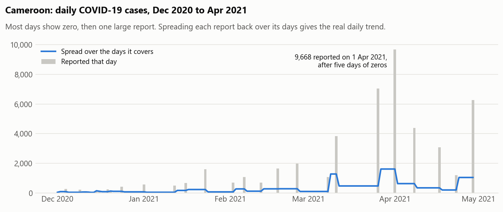
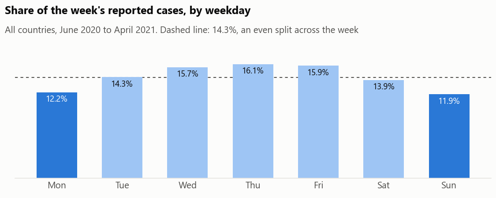

# How far can you trust daily COVID-19 numbers? A MySQL data-quality study

> **In short:** During COVID-19, governments and the news relied on daily case numbers. I checked how far those numbers could be trusted across 208 countries. Many countries reported in bursts (several days of zero, then one big number), weekends carried about a quarter fewer cases than weekdays, and countries that tested less appeared to have higher death rates. I built a way to correct the bursts so the real daily trend shows again.
>
> **What it shows:** I check whether data can be trusted before drawing conclusions from it, which matters just as much for a hospital or business report.

The daily case counts that drove 2020–21 dashboards were shaped by how countries reported them: weekends, weekly batches, missing days, corrections, and uneven testing. This project measures those effects across 208 countries in the Our World in Data snapshot to 30 April 2021, and fixes the biggest one with SQL.

**Tools:** MySQL 8: recursive CTEs (date spines), gaps-and-islands with window functions, `NTILE`, generated columns.



## What I found

**1. One in seven large-outbreak countries reported in batches, and spreading the batches back fixes most of the noise.** 21 of the 146 countries with 10,000+ cases reported zero on at least a quarter of days after their first case. Cameroon reported zero on 65% of days, then 9,668 cases on 1 April 2021 after five days of zeros. Spreading each report evenly over the days it covers keeps every country's total exactly the same and cuts the average day-to-day swing by 87% in Cameroon, 91% in Botswana, 81% in Sweden and 78% in Spain. Ten of the 21 are in Africa, but Sweden and Spain show the same pattern because they stopped reporting at weekends.

**2. Sundays and Mondays carry about a quarter fewer cases than Thursdays.** From June 2020 onwards, Sunday accounts for 11.9% of each week's reported cases and Thursday for 16.1%, against 14.3% if reporting were even. Any analysis of daily data needs a 7-day average or weekday adjustment before comparing days.



**3. Where testing was thin, death rates look twice as high.** Splitting 112 countries into quarters by tests per confirmed case, the quarter that tested least (under 7 tests per case) has an average case fatality rate of 2.86%. The quarter that tested most (25+ per case) has 1.31%. Low testing finds mainly the severe cases, so the share who die looks larger. Country CFRs aren't comparable without knowing testing levels.

**4. By 30 April 2021, 1% of Africans had a first vaccine dose, against 21% of Europeans.** North America was at 29.5%. Nigeria's first doses appear in this data on 15 March 2021; six weeks later 1.19 million people, 0.58% of the population, had one dose. 13 of 55 African countries had no vaccination data at all by that date.

## Data quality issues found first

`02_quality_checks.sql` runs before the analysis. Its full output is in [`results/02_quality_checks_output.txt`](results/02_quality_checks_output.txt).

| Issue | Rows | Countries |
|---|---|---|
| Whole days missing from the series (found with a recursive date spine) | 389 | 5 |
| Negative daily cases (corrections) | 61 | 38 |
| Negative daily deaths (corrections) | 80 | 41 |
| Cumulative tests lower than cumulative cases | 14 | 5 |
| No testing data at all | n/a | 93 |

Hong Kong is missing 316 days between February 2020 and February 2021. Because the date spine is built from each country's own first and last report, it catches days that never arrived, which a simple `GROUP BY date` cannot.

## How the batch spreading works

A batch is a run of zero days followed by one positive report. The SQL gives every day a `batch_id` equal to the number of positive reports **before** it:

```sql
SUM(new_cases > 0) OVER (PARTITION BY location ORDER BY report_date
                         ROWS BETWEEN UNBOUNDED PRECEDING AND 1 PRECEDING)
```

The zero days after report *k* and report *k+1* itself share the same id, so averaging within that id spreads each report over the days it covers. Two edge cases are handled explicitly: negative corrections stay on their own day and are kept out of the average (so totals match to the case), and zero days at the very end whose report hadn't arrived by 30 April are left blank rather than shown as zero.

This builds on a gap-filling exercise I did with a 7-row sample table (recursive CTE date series plus `LAG`/`LEAD`). Here the same idea is applied to 80,000 real rows, where the gaps are zeros rather than missing rows.

## Reproduce

Requires MySQL 8 with `local_infile` enabled. From the repository root:

```bash
mysql --local-infile=1 -u root -p < sql/01_load.sql
mysql -u root -p --table < sql/02_quality_checks.sql
mysql -u root -p --table < sql/03_analysis.sql
```

```
sql/01_load.sql             loads the CSV; flags OWID aggregate rows (World, Africa, ...) instead of deleting them
sql/02_quality_checks.sql   missing days, corrections, testing gaps, batch reporters
sql/03_analysis.sql         the four questions; builds the `spread` table
data/                       15 of the 59 OWID columns, 85,171 rows
results/                    saved output of both scripts, and the chart data
charts/make_charts.py       draws the two charts from results/
```

## Source and credit

Data: [Our World in Data COVID-19 dataset](https://github.com/owid/covid-19-data), snapshot to 30 April 2021, trimmed to the columns used here. I first used this snapshot in Alex Freeberg's (Alex The Analyst) SQL portfolio project, and the date-gap technique comes from Alice Zhao's advanced SQL walkthrough. The questions, quality checks, batch-spreading method and findings in this repository are my own.
